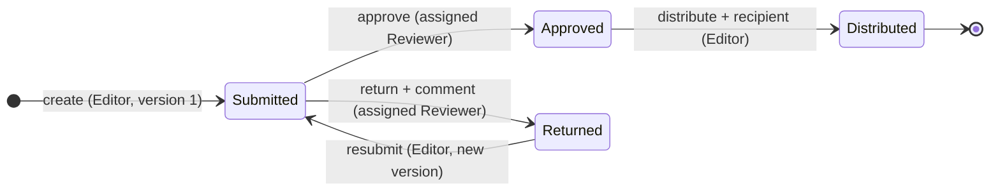
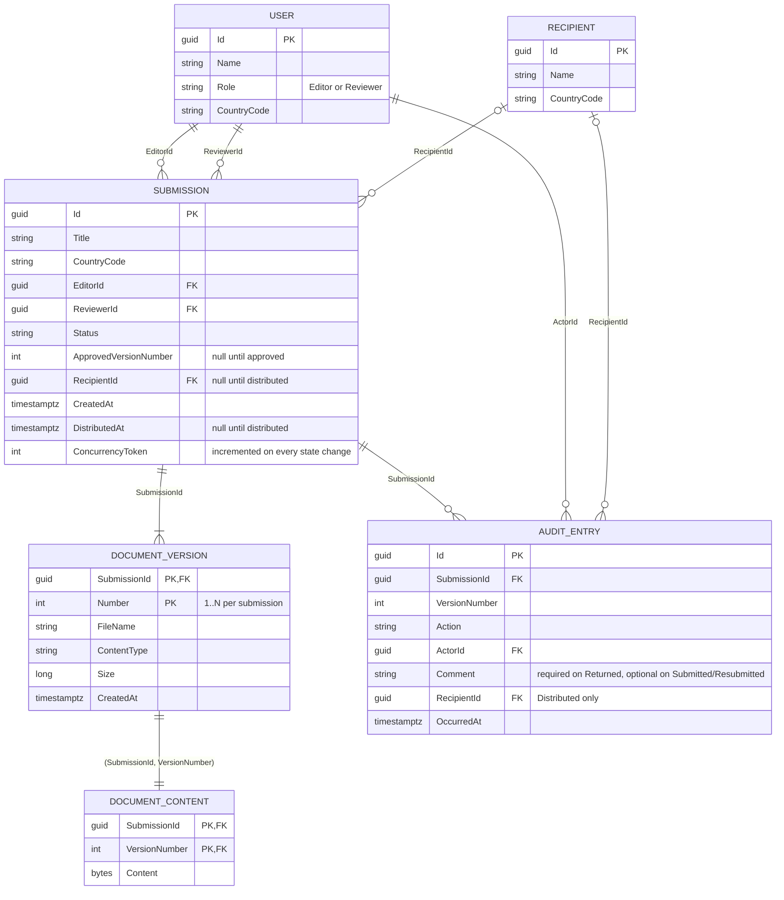

# Country Document Submission — Specification

Each requirement has an ID and an acceptance criterion; §5 lists the tests that cover them.

## 1. Workflow

A **submission** is the workflow record for one document going through a fixed, two-step process:

1. **Decision step** — Editor uploads a document, picks a Reviewer, submits. Reviewer approves or returns it.
2. **Distribution step** — after approval, Editor selects a recipient and the step is recorded. Done.

Every user belongs to one country; a submission belongs to its Editor's country, and both steps happen within that country.

## 2. Technology

| Area | Choice |
|------|--------|
| Runtime | .NET 10 (LTS), C# |
| Web | ASP.NET Core Web API with controllers |
| Data | EF Core 10 with the Npgsql provider; PostgreSQL in Docker |
| Authentication | JWT bearer tokens; role-based authorization policies |
| API documentation | OpenAPI document with an interactive UI |
| Errors | ProblemDetails, with one `IExceptionHandler` for domain exceptions |
| Time | UTC; domain methods receive the current time as a parameter |
| Tests | xUnit; `WebApplicationFactory` + Testcontainers (PostgreSQL) for integration tests |
| UI | Blazor WebAssembly with Bootstrap, served by the API under `/ui` (same origin, Development only) |
| Run | Docker Compose |

Solution layout:

| Project | Contains | Depends on |
|---------|----------|------------|
| `DocumentSubmission.Domain` | Entities, workflow rules, domain exceptions | nothing |
| `DocumentSubmission.Infrastructure` | `DbContext`, EF configuration, migrations, seed data | Domain |
| `DocumentSubmission.Api` | Controllers, auth, file validation, error mapping, thin use-case services | Domain, Infrastructure |
| `DocumentSubmission.Domain.Tests` | Unit tests for the domain | Domain |
| `DocumentSubmission.Api.IntegrationTests` | HTTP and database integration tests | Api |
| `DocumentSubmission.Web` | UI pages, one API client | nothing (calls the API over HTTP; the Api project references it only to serve its files) |

## 3. Domain model

Key fields and relationships only — exact column types and constraints live in the EF Core configuration and migrations.

Line labels are the foreign keys (composite keys in parentheses). Line ends: `||` one, `o|` zero or one, `|{` one or more, `o{` zero or more (mirrored on the left end).

### Entities

- **Submission** — the aggregate root. Owns its document versions and audit entries. Its state changes only through the methods below; every change increments `ConcurrencyToken`. `ApprovedVersionNumber` and `AuditEntry.VersionNumber` are plain numbers set only by these methods.
- **DocumentVersion** — immutable once created. Identified by `(SubmissionId, Number)`, with `Number` running 1..N per submission. Metadata only. The *current* version is the one with the highest `Number`.
- **DocumentContent** — the file bytes, 1:1 with a version, in a separate table so list and detail queries never load them.
- **AuditEntry** — append-only. Created only by `Submission`, saved in the same transaction as the state change.
- **User**, **Recipient** — seeded, read-only reference data.
- **DocumentFile** — value object passed into the domain (file name, content type, bytes), so the domain never sees `IFormFile`.

The domain assigns all Ids (`Guid.NewGuid()`) when it creates an entity, because versions and audit entries need the `SubmissionId` before the first save. EF is configured with `ValueGeneratedNever()`; otherwise it treats a new child with a preset key as an existing row and issues an `UPDATE`.

### Submission behaviour

| Method | Allowed when | Who / preconditions | Effect | Audit action (version recorded) |
|--------|--------------|---------------------|--------|--------------------------------|
| `Create(editor, reviewer, title, file, comment?)` | — | Editor; Reviewer eligible (R7) | Status `Submitted`; version 1 | `Submitted` (v1) |
| `Resubmit(editor, file, comment?)` | `Returned` | Creating Editor | New version N+1; status `Submitted` | `Resubmitted` (new version) |
| `Approve(reviewer, versionNumber)` | `Submitted` | Assigned Reviewer, in the submission's country; `versionNumber` is the current version | Status `Approved`; `ApprovedVersionNumber` = `versionNumber` | `Approved` (decided version) |
| `Return(reviewer, versionNumber, comment)` | `Submitted` | Assigned Reviewer, in the submission's country; `versionNumber` is the current version; comment required | Status `Returned` | `Returned` (decided version) |
| `Distribute(editor, recipient)` | `Approved` | Creating Editor; Recipient eligible (R19) | Status `Distributed`; `RecipientId`, `DistributedAt` set | `Distributed` (approved version) |

## 4. Requirements

### Request processing

**Visibility rule:** a submission is visible only to its creating Editor and its assigned Reviewer. Every `/submissions/{id}` route applies it.
- A caller whose role the endpoint does not allow gets `403`, whatever the id.
- A caller with an allowed role who is not a participant gets `404`, the same as for a non-existent id — existence is never leaked.

**Check order** (follows the ASP.NET Core pipeline; the first failing check decides the response):

| # | Check | Response |
|---|-------|----------|
| 1 | Authentication | `401` |
| 2 | Role policy | `403` |
| 3 | Request: content type, required fields, lengths, uploaded file | `415` / `400` |
| 4 | Visibility | `404` |
| 5 | Eligible Reviewer/Recipient | `400` |
| 6 | Workflow state, stale `versionNumber`, concurrent change | `409` |

**Error mapping** (one `IExceptionHandler`):

| Source | Response |
|--------|----------|
| `NotFoundException` | `404` |
| `NotAllowedException` (domain actor check, defence in depth) | `403` |
| `InvalidInputException` | `400` |
| `InvalidStateException` | `409` |
| `DbUpdateConcurrencyException`; primary key violation on `DocumentVersions` | `409` |
| `BadHttpRequestException` | its own status code |
| Anything else | `500`, without internal details |

### Authentication & access

| ID | Requirement | Acceptance criteria |
|----|-------------|---------------------|
| R1 | Two roles: Country Editor and Country Reviewer. Each user has exactly one role and one country. | Seed data: ≥ 2 Editors and ≥ 2 Reviewers in one country, ≥ 1 of each in a second country, Recipients in both — all with fixed, documented Ids. |
| R2 | Simplified login issues a JWT, in Development only. | `POST /auth/login` with `{ "userId": "…" }` returns a token with `sub`, `role` and `country` claims. Unknown user → `401`. `GET /auth/users` lists the users that can log in (Id, name, role, country). Both outside Development → `404`. |
| R3 | All other endpoints require authentication. | No token → `401`. |
| R4 | Submissions are visible only to their participants. | Every `/submissions/{id}` route follows the visibility rule above. |

### Decision step

| ID | Requirement | Acceptance criteria |
|----|-------------|---------------------|
| R5 | Only Editors can create submissions. | Reviewer → `403`. |
| R6 | Create = title + document + reviewer; the decision step is submitted immediately. | `201` with `Location`; status `Submitted`; version 1; creator and country = caller's. Title required, ≤ 200 characters, otherwise `400`. Optional comment for the Reviewer (R26). |
| R7 | The selected Reviewer must be eligible. | Exists, has role Reviewer, same country as the Editor; otherwise `400`. |
| R8 | Editors can list eligible Reviewers. | `GET /reviewers` returns only the caller's country. Reviewer → `403`. |
| R9 | Only the assigned Reviewer can approve or return. | Editors → `403`; other Reviewers → `404`. |
| R10 | Approve/return only while `Submitted`, and only for the version the Reviewer reviewed. | `versionNumber` required (≥ 1), otherwise `400`. Not the current version → `409`. Other status → `409`. |
| R11 | Return requires a comment. | Required, ≤ 2000 characters, otherwise `400`. Status → `Returned`. |
| R12 | Only the creating Editor can resubmit, only while `Returned`. | New document (R16); optional comment, e.g. what changed (R26); same Reviewer; status → `Submitted`. Reviewers → `403`; other Editors → `404`; wrong state → `409`. |
| R26 | The Editor can add a comment when submitting or resubmitting. | Optional, ≤ 2000 characters, otherwise `400`; blank is treated as none. Stored on the `Submitted` / `Resubmitted` audit entry. |

### Document history

| ID | Requirement | Acceptance criteria |
|----|-------------|---------------------|
| R13 | Each submit/resubmit creates an immutable document version. | Versions numbered 1..N; never updated or deleted; all listed in the details (R25). |
| R14 | Approval pins the approved version. | `approvedVersionNumber` = the approved `versionNumber`; never changes afterwards. |
| R15 | Any version can be downloaded. | `GET /submissions/{id}/versions/{versionNumber}/content` returns the original bytes, the server-detected `Content-Type`, `Content-Disposition: attachment` with the file name, and `X-Content-Type-Options: nosniff`. Unknown version → `404`. |
| R16 | Uploads are validated. | PDF or DOCX only (extension and file signature agree); non-empty; ≤ 10 MB; file name non-empty and ≤ 255 characters. Otherwise `400`. `ContentType` is set by the server, never taken from the client. |

### Distribution step

| ID | Requirement | Acceptance criteria |
|----|-------------|---------------------|
| R17 | Editors can list eligible Recipients. | `GET /recipients` returns only the caller's country. Reviewer → `403`. |
| R18 | Only the creating Editor can distribute, only while `Approved`. | Reviewers → `403`; other Editors → `404`; wrong state → `409`. |
| R19 | The selected Recipient must be eligible. | Exists and belongs to the submission's country; otherwise `400`. |
| R20 | Distribution completes the workflow. | Status → `Distributed`; recipient and timestamp stored; no further actions (`409`). |

### Audit trail

| ID | Requirement | Acceptance criteria |
|----|-------------|---------------------|
| R21 | Every workflow action is audited. | `Submitted`, `Returned`, `Resubmitted`, `Approved`, `Distributed` — each with actor, UTC timestamp, version, and comment or recipient where relevant. |
| R22 | Audit is written atomically with the state change. | If saving fails, neither the state change nor the audit entry is persisted. |
| R23 | Audit trail is retrievable through the API. | `GET /submissions/{id}/audit` → chronological list. No update/delete endpoints. |

### Queries

| ID | Requirement | Acceptance criteria |
|----|-------------|---------------------|
| R24 | Users list their own work. | `GET /submissions` → Editor: created by them; Reviewer: assigned to them. Newest first, with status. |
| R25 | Submission details. | `GET /submissions/{id}` → status, participants, all versions (metadata), approved version number, recipient. |

### Non-functional

| ID | Requirement | Acceptance criteria |
|----|-------------|---------------------|
| N1 | Conflicting concurrent actions are safe. | Of two conflicting state-changing requests on the same submission, one succeeds and the other gets `409`, never `500`. |
| N2 | Consistent errors. | Every error response is RFC 9457 ProblemDetails (`application/problem+json`). |
| N3 | One-command run. | `docker compose up` starts the API (Development) and Postgres; the API waits for the Postgres healthcheck, then applies migrations and seed data. |
| N4 | API documentation. | OpenAPI document and interactive UI in Development. |
| N5 | Efficient queries. | List and detail queries are no-tracking projections that never load file bytes. |
| N6 | Fictional data only. | Seed data contains no real people or organisations. |
| N7 | Documented run and test instructions. | README explains how to run the API and the tests (Docker required for integration tests), lists the seeded user Ids, and summarises sections 6–8. |

## 5. Tests

**Unit tests** (`Domain.Tests`) cover the workflow rules — one test class per `Submission` method. Every transition test also asserts the audit entry it writes (R21) and that `ConcurrencyToken` was incremented (N1).

| Test class | Covers |
|------------|--------|
| `CreateTests` | R6, R7, R26 |
| `ApproveTests`, `ReturnTests` | R9, R10, R11, R14 |
| `ResubmitTests` | R12, R13, R26 |
| `DistributeTests` | R18, R19, R20 |

**Integration tests** (`Api.IntegrationTests`) cover HTTP concerns and persistence. They run in Development, log in through `/auth/login` with seeded users, and share one Postgres container; each test creates its own submissions. Every error case asserts ProblemDetails through a shared helper (N2).

| Test | Covers |
|------|--------|
| `Login_KnownUser_ReturnsTokenWithClaims`, `Login_UnknownUser_Returns401`, `Login_OutsideDevelopment_Returns404`, `ListUsers_ReturnsSeededUsersWithoutToken`, `ListUsers_OutsideDevelopment_Returns404` | R2 |
| `ProtectedEndpoints_WithoutToken_Return401` (every endpoint) | R3 |
| `WrongRole_Returns403` (endpoint × role) | R5, R8, R9, R12, R17, R18 |
| `SubmissionRoutes_NonParticipant_Return404` (route × non-participant) | R4, R9, R12, R18 |
| `InvalidRequest_Returns400` (title, comments, `versionNumber`, file type/signature/size/name) | R6, R10, R11, R16, R26 |
| `IneligibleReference_Returns400` (reviewer on create, recipient on distribute) | R7, R19 |
| `WrongState_Returns409` (wrong status, stale `versionNumber`, action after distribution) | R10, R12, R18, R20 |
| `FullWorkflow_CreateReturnResubmitApproveDistribute` — asserts `201` + `Location`, all versions, approved version, downloads, audit trail order | R6, R13, R14, R15, R21, R23, R25 |
| `Upload_ValidDocx_Succeeds`, `DownloadVersion_UnknownVersion_Returns404` | R15, R16 |
| `ReferenceLists_ReturnOnlyCallersCountry` | R8, R17 |
| `ListSubmissions_EditorSeesOwn_ReviewerSeesAssigned_NewestFirst` | R24 |
| `ConcurrentActions_SecondIsRejectedAndSavesNothing` (approve vs return; double resubmit — two `DbContext`s) | N1, R22 |
| `ExceptionHandler_MapsConcurrencyErrorsTo409` | N1 |

**Manual / review:** N3, N7 (follow the README on a clean machine), N4, N5, N6, R1.

## 6. Assumptions

- A user has exactly one role and one country; users are seeded, not managed through the API.
- Visibility is limited to the creating Editor and the assigned Reviewer, not the whole country.
- The Reviewer is chosen at creation and cannot be changed, so resubmissions go back to the Reviewer who gave the feedback. Reassignment is out of scope.
- Creating a submission submits it immediately — there are no drafts.
- Only the creating Editor can resubmit or distribute.
- Recipients are seeded, country-scoped reference data. Distribution only records the selected recipient; nothing is delivered.
- A returned submission can be resubmitted any number of times; there is no withdraw action.
- Documents are PDF or DOCX, up to 10 MB. For DOCX, the signature check only confirms a ZIP container.
- The login endpoint exists only in Development.
- All timestamps are UTC.

## 7. Decisions & trade-offs

| Decision | Why | Trade-off |
|----------|-----|-----------|
| Single API (monolith) + Postgres in Docker | One workflow; simple to run and explain. | Not independently scalable — not needed here. |
| Controllers rather than minimal APIs | Familiar structure; attribute-based authorization and validation per endpoint. | Slightly more ceremony. |
| Workflow rules in the `Submission` entity | Invalid transitions are impossible; rules are unit-testable without HTTP or database; audit can't be forgotten. | Entity carries behaviour, not just data. |
| Thin services using `DbContext` directly; no repositories | `DbContext` already is a repository + unit of work. | Use cases depend on EF Core. |
| Typed domain exceptions mapped in one `IExceptionHandler` | Domain stays HTTP-agnostic; the whole mapping is in one place. | Exceptions for expected outcomes, rather than a result type. |
| Audit written by the aggregate in the same transaction | Atomic; no domain events or messaging. | Audit is not a separate service. |
| PostgreSQL | Lightweight container, mature EF Core provider. | Changing database means swapping the provider and regenerating migrations. |
| Explicit `ConcurrencyToken` column | Optimistic concurrency, visible in the schema, works with any database; incremented in one `Transition()` method. | One extra column to maintain. |
| Approve/return name the version (`versionNumber`) | The Reviewer decides on the snapshot they actually saw, even from a stale browser tab. | One extra request field. |
| Testcontainers Postgres for integration tests | Real constraints, transactions and concurrency (unlike EF InMemory). | Docker needed to run them. |
| File bytes in the database, separate table | Transactional with the version row; simple to deploy. | Blob storage would be the production choice for large files. |
| Dev JWT login instead of an identity provider | Exercises the real auth pipeline with minimal code; Development only. | Not production authentication. |

## 8. API

All endpoints except login require `Authorization: Bearer <token>`.
`{id}` and `{versionNumber}` are route parameters (`versionNumber` is `DocumentVersion.Number`).

Responses: create → `201 Created` with the submission and a `Location` header; workflow actions → `200 OK` with the updated submission (same shape as `GET /submissions/{id}`); download → the file (R15); errors → ProblemDetails (N2).

| Method | Path | Who | Request body | Purpose |
|--------|------|-----|--------------|---------|
| GET | `/auth/users` | anyone (Development only) | — | Users that can log in → `[{ id, name, role, countryCode }]` |
| POST | `/auth/login` | anyone (Development only) | JSON `{ "userId": "…" }` | Dev login → `{ token, expiresAt }` |
| GET | `/reviewers` | Editor | — | Eligible reviewers in caller's country |
| GET | `/recipients` | Editor | — | Eligible recipients in caller's country |
| GET | `/submissions` | Editor, Reviewer | — | Own (Editor) / assigned (Reviewer) submissions, newest first |
| POST | `/submissions` | Editor | multipart: `title`, `reviewerId`, `file`, optional `comment` | Create + submit decision step |
| GET | `/submissions/{id}` | participants | — | Details, including all version metadata |
| POST | `/submissions/{id}/resubmit` | creating Editor | multipart: `file`, optional `comment` | New version |
| POST | `/submissions/{id}/approve` | assigned Reviewer | JSON `{ "versionNumber": 2 }` | Approve the named (current) version |
| POST | `/submissions/{id}/return` | assigned Reviewer | JSON `{ "versionNumber": 2, "comment": "…" }` | Return for revision |
| POST | `/submissions/{id}/distribute` | creating Editor | JSON `{ "recipientId": "…" }` | Complete the workflow |
| GET | `/submissions/{id}/versions/{versionNumber}/content` | participants | — | Download a version |
| GET | `/submissions/{id}/audit` | participants | — | Audit trail |

## 9. UI

A thin client of the API in §8; it has no data or rules of its own. It runs in the browser and is served by the API under `/ui`, in Development only (it relies on the Development login). Same origin, so no CORS; every API call is a normal browser request. Any `/ui/...` path that is not a file returns the app's `index.html`.

| Page | Who | Content |
|------|-----|---------|
| Login | anyone (Development only) | Pick a user from `GET /auth/users` → `POST /auth/login`. The token is kept in memory; reloading the page logs out. |
| Submissions | Editor, Reviewer | `GET /submissions`; Editors also get "New submission". |
| New submission | Editor | Title, Reviewer (`GET /reviewers`), file, optional comment → `POST /submissions`. |
| Submission details | participants | Status, participants, versions with downloads, approved version, recipient, audit trail, and the actions below. |

**The UI hides actions that cannot succeed; the API stays the authority.** An action is shown only to the user and status the API allows: approve/return for the assigned Reviewer while `Submitted` (sending the version shown on the page), resubmit for the creating Editor while `Returned`, distribute for the creating Editor while `Approved`. API errors are shown from the ProblemDetails `title` and `detail`; a `401` returns to the login page.

## 10. Out of scope

- User management, real identity provider, notifications/delivery.
- Pagination and filtering of submission lists.
- Rate limiting and throttling.
- AI-assisted document preparation — to be designed separately.
